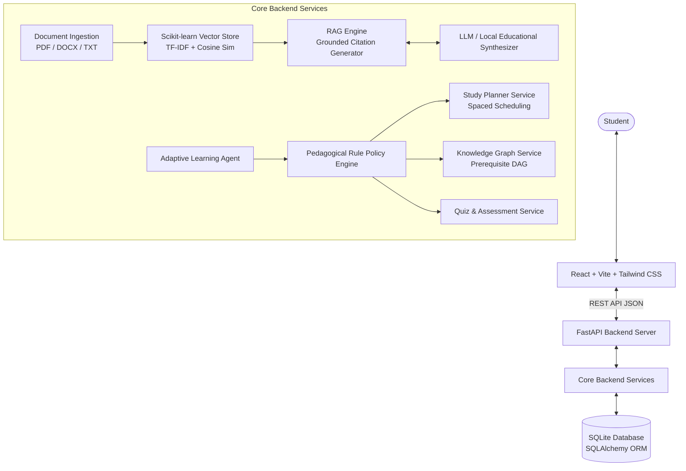

# AI-Based Personalized Study Assistant 🎓🤖

An intelligent, full-stack adaptive learning platform that models student learning states, generates personalized study schedules, represents course curricula as a prerequisite knowledge graph, acts as an adaptive pedagogical agent, and uses Retrieval-Augmented Generation (RAG) to answer questions directly grounded in uploaded lecture notes.

---

## 🌟 Key Features

### 1. Student Profile & Cognitive Learning State Model
- Tracks dynamic topic mastery on a continuous scale from `0.0` to `1.0`.
- Implements structured learning state outputs according to the specification:
  ```json
  {
    "topic": "Computer Networks",
    "mastery_score": 0.65,
    "confidence": 0.60,
    "last_studied": "2026-10-20",
    "quiz_accuracy": 0.70,
    "revision_needed": true
  }
  ```
- Updates mastery in real-time through authentic student activities, study tasks, and quiz submissions (no randomized placeholders).

### 2. Retrieval-Augmented Generation (RAG) Study Chatbot
- Multi-format document parser: Supports **PDF** (`pypdf`), **DOCX** (`python-docx`), and **TXT**.
- Recursive text chunker preserving page numbers and paragraph boundaries.
- In-memory Scikit-learn TF-IDF & Cosine Similarity vector store backed by SQLite chunks.
- Grounded citations: Every answer explicitly cites the **document name**, **page number**, and relevant excerpt.
- Pre-built study prompt modes:
  - *Simple English*: Breaks complex topics into bite-sized analogies.
  - *With Examples*: Connects theoretical protocols to real-world mechanisms.
  - *Unit Summary*: Highlights critical exam formulas and definitions.
  - *Practice MCQs*: Generates grounded quiz questions on the fly.
  - *Exam Probability*: Extracts high-yield exam areas.
  - *Concept Comparison*: Tabular side-by-side contrast (e.g., OSI vs TCP/IP).
- Reliable Grounding: Explicitly informs the student when notes do not contain sufficient data rather than hallucinating citations.

### 3. Course Knowledge Representation (Prerequisite DAG)
- Represents curriculum structure as a Directed Acyclic Graph (DAG).
- Validates prerequisite dependencies before topics can be unlocked.
- Color-coded interactive knowledge map:
  - 🟢 **Completed** ($\ge 80\%$ mastery)
  - 🟡 **In Progress** ($50\% - 79\%$ mastery)
  - 🔴 **Weak / Needs Revision** ($< 50\%$ mastery)
  - ⚪ **Locked** (Unsatisfied prerequisites)

### 4. Adaptive Learning Agent
- Observe: Watches quiz attempts, study durations, and revision decay.
- Evaluate: Identifies knowledge gaps and calculates exponential moving average mastery:
  $$M_{new} = \alpha \cdot M_{old} + (1 - \alpha) \cdot A_{quiz}$$
- Rule-based explainable action policy:
  - Quiz Accuracy $< 50\% \implies$ `review_concept` (recommends simplified chat review)
  - Quiz Accuracy $50\% - 79\% \implies$ `targeted_practice` (recommends medium quiz)
  - Quiz Accuracy $\ge 80\% \implies$ `advance_topic` (recommends next unlocked curriculum node)
  - Inactivity $> 5$ days $\implies$ `schedule_revision` (spaced repetition alert)

### 5. Personalized Study Plan Generator
- Schedules tasks from today up to target exam date based on daily available hours.
- Prioritizes topics with low mastery and unmet prerequisites.
- Automatically interleaves spaced revision sessions and cognitive rest breaks.
- Direct task completion checkboxes feed straight back into the student's mastery vector.

### 6. Quiz & Assessment Engine
- Topic or document-driven 4-choice MCQ generator.
- Configurable difficulty: Easy, Medium, and Hard.
- Real-time scoring, percentage, and detailed question-by-question explanations.
- Records attempt history and adjusts learning state.

---

## 🏗️ System Architecture



---

## 💻 Tech Stack

- **Frontend**: React 18, Vite, Tailwind CSS v4, Lucide React, Recharts
- **Backend**: Python 3.11+, FastAPI, Uvicorn, SQLAlchemy, Pydantic v2
- **Document Processing**: PyPDF, python-docx
- **Vector Search & ML**: Scikit-Learn (TF-IDF & Cosine Similarity Matrix), NumPy
- **Database**: SQLite (Zero configuration required)
- **Testing**: Pytest

---

## 🚀 Quickstart & Installation

### Prerequisites
- **Python 3.10+** (Tested on Python 3.13)
- **Node.js 18+** and **npm**

---

### Step 1: Backend Setup

1. Open a terminal in the project root:
   ```bash
   cd backend
   ```

2. Create and activate a Python virtual environment:
   - **Windows (PowerShell)**:
     ```powershell
     python -m venv venv
     .\venv\Scripts\Activate.ps1
     ```
   - **macOS / Linux**:
     ```bash
     python3 -m venv venv
     source venv/bin/activate
     ```

3. Install backend dependencies:
   ```bash
   pip install -r requirements.txt
   ```

4. Start the FastAPI development server:
   ```bash
   uvicorn app.main:app --host 127.0.0.1 --port 8000 --reload
   ```

   The backend will start at `http://127.0.0.1:8000`.
   - Interactive Swagger API Documentation: `http://127.0.0.1:8000/docs`
   - Health check: `http://127.0.0.1:8000/api/health`

---

### Step 2: Frontend Setup

1. Open a second terminal window in the project root:
   ```bash
   cd frontend
   ```

2. Install dependencies:
   ```bash
   npm install
   ```

3. Start Vite development server:
   ```bash
   npm run dev
   ```

4. Open your browser and navigate to:
   ```
   http://localhost:5173
   ```

---

## ⚙️ Environment Variables (`.env`)

A default `.env.example` is included in the project root. To customize:

```bash
cp .env.example .env
```

| Variable | Default | Purpose |
| :--- | :--- | :--- |
| `USE_MOCK_AI` | `true` | When `true`, uses local high-performance grounded generator without requiring paid API keys |
| `OPENAI_API_KEY` | `""` | Optional: OpenAI key for `gpt-4o-mini` |
| `GEMINI_API_KEY` | `""` | Optional: Google Gemini key for `gemini-1.5-flash` |
| `DATABASE_URL` | `sqlite:///study_assistant.db` | SQLite database connection string |
| `RETRIEVAL_TOP_K`| `4` | Number of context chunks retrieved per query |
| `SIMILARITY_THRESHOLD` | `0.15` | Minimum cosine similarity threshold for RAG grounding |

---

## 🧪 Running Automated Tests

Run the complete backend test suite covering learning-state updates, study-plan generation, document ingestion, RAG retrieval, quiz scoring, and knowledge graph prerequisites:

```bash
cd backend
python -m pytest
```

---

## 🗺️ Step-by-Step User Journey

1. **Dashboard Overview**: Check your overall mastery %, active learning streak, and top recommendations generated by the Adaptive Learning Agent.
2. **Explore Knowledge Map**: Click **Knowledge Map** in the sidebar to visualize prerequisite chains from *Network Fundamentals* to *Subnetting*.
3. **Upload Notes or Ask AI**:
   - Go to **AI Study Chat**.
   - Notice the pre-indexed *Computer Networks Lecture Notes* ready for questions.
   - Choose a mode (e.g. *Simple English* or *With Example*) and ask: `"Explain Cyclic Redundancy Check (CRC)"`.
   - Inspect the exact document citation and page number.
4. **Take an Adaptive Quiz**:
   - Navigate to **Quiz & Practice**.
   - Select *Error Detection & CRC* or *OSI Model*, choose difficulty, and test your retention.
   - Submit the quiz to view your score, review explanations, and observe your topic mastery update immediately.
5. **Personalized Study Planner**:
   - Go to **Study Planner**, set your target exam date and daily available hours, and click **Regenerate Plan**.
   - Check off completed tasks to increment your daily progress!
6. **Analytics & Raw JSON**:
   - Go to **Analytics & State** to inspect the structured learning state model, quiz trend line, and study time area chart.
   - Click **Export Learning State JSON** to view or export the structured student state model.

---

## 🛡️ License

Built for academic & college-level AI/ML project demonstrations. Distributed under the MIT License.
